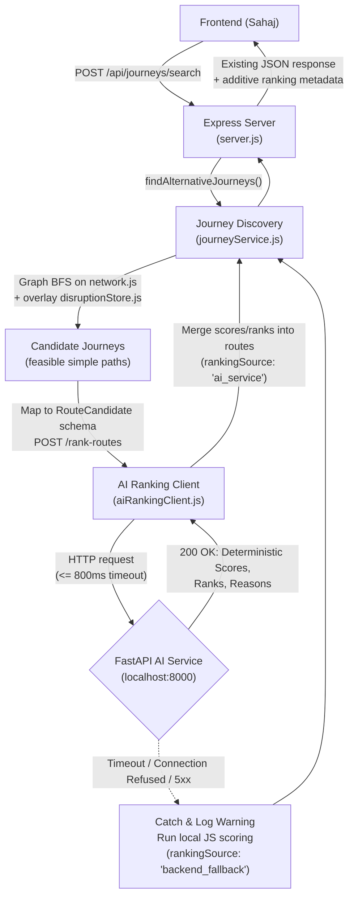
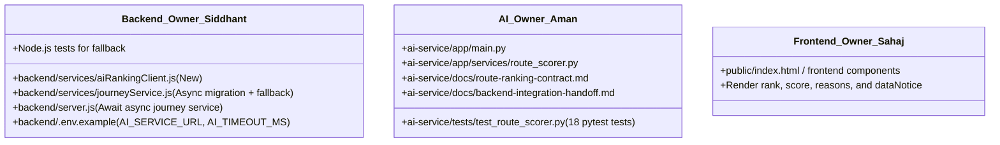

# SAFAR Backend Integration Handoff Guide

**Target Audience:** Backend Engineer (`backend/`)  
**Author:** Aman Tyagi (AI/ML Service Owner, `ai-service/`)  
**Reference Specification:** [route-ranking-contract.md](file:///Users/amantyagi/Desktop/idp/safar/ai-service/docs/route-ranking-contract.md)  
**FastAPI Version:** `0.2.0`  
**Endpoint:** `POST /rank-routes` (Default: `http://127.0.0.1:8000/rank-routes`)

---

## 1. Architecture Overview



### Separation of Responsibilities
- **Express Backend:** Owns origin/destination resolution, graph exploration, timetable/fare accumulation, transfer calculations, disruption store lookups, and journey candidate generation.
- **FastAPI AI Service:** Pure deterministic scoring engine. Normalizes candidate metrics (time, fare, transfers, optional delays/reliability), applies preference weights, and returns relative scores (0–100), explicit ranks, and explanations. It never synthesizes or alters stops, legs, connections, or fares.

---

## 2. Request and Response Examples

### Request: `POST /rank-routes`

```json
{
  "routes": [
    {
      "route_id": "TAMBARAM-GUINDY-CENTRAL",
      "travel_time_minutes": 30.0,
      "expected_delay_minutes": 5.0,
      "fare": 15.0,
      "transfers": 1,
      "cancelled": false,
      "is_available": true,
      "connectionIds": ["C1", "C3"],
      "origin": { "id": "TAMBARAM", "name": "Tambaram" },
      "destination": { "id": "CENTRAL", "name": "Chennai Central" },
      "segments": [
        {
          "connectionId": "C1",
          "from": "TAMBARAM",
          "to": "GUINDY",
          "mode": "train",
          "durationMinutes": 20,
          "fare": 10
        },
        {
          "connectionId": "C3",
          "from": "GUINDY",
          "to": "CENTRAL",
          "mode": "bus",
          "durationMinutes": 10,
          "fare": 5
        }
      ]
    },
    {
      "route_id": "TAMBARAM-EGMORE-CENTRAL",
      "travel_time_minutes": 55.0,
      "expected_delay_minutes": 0.0,
      "fare": 25.0,
      "transfers": 1,
      "cancelled": false,
      "is_available": true,
      "connectionIds": ["C4", "C3"],
      "origin": { "id": "TAMBARAM", "name": "Tambaram" },
      "destination": { "id": "CENTRAL", "name": "Chennai Central" }
    }
  ],
  "preference": "balanced",
  "max_fare": 50.0,
  "max_transfers": 2
}
```

### Response: `200 OK`

```json
{
  "preference": "balanced",
  "input_count": 2,
  "eligible_count": 2,
  "excluded_count": 0,
  "routes": [
    {
      "route_id": "TAMBARAM-GUINDY-CENTRAL",
      "travel_time_minutes": 30.0,
      "fare": 15.0,
      "transfers": 1,
      "expected_delay_minutes": 5.0,
      "reliability": null,
      "disruption_severity": null,
      "cancelled": false,
      "is_available": true,
      "connectionIds": ["C1", "C3"],
      "origin": { "id": "TAMBARAM", "name": "Tambaram" },
      "destination": { "id": "CENTRAL", "name": "Chennai Central" },
      "segments": [ ... ],
      "score": 100.0,
      "preference": "balanced",
      "reasons": [
        "Ranks well for lower fare.",
        "Includes 5.0 minutes of reported expected delay."
      ],
      "score_components": {
        "time": 0.0,
        "fare": 0.0,
        "transfers": 0.0
      },
      "rank": 1
    },
    {
      "route_id": "TAMBARAM-EGMORE-CENTRAL",
      "travel_time_minutes": 55.0,
      "fare": 25.0,
      "transfers": 1,
      "expected_delay_minutes": 0.0,
      "reliability": null,
      "disruption_severity": null,
      "cancelled": false,
      "is_available": true,
      "connectionIds": ["C4", "C3"],
      "origin": { "id": "TAMBARAM", "name": "Tambaram" },
      "destination": { "id": "CENTRAL", "name": "Chennai Central" },
      "score": 20.0,
      "preference": "balanced",
      "reasons": [
        "Ranks well for fewer transfers."
      ],
      "score_components": {
        "time": 50.0,
        "fare": 30.0,
        "transfers": 0.0
      },
      "rank": 2
    }
  ],
  "excluded": [],
  "result_status": "ranked",
  "metadata": {
    "ranking_mode": "deterministic_weighted_scoring",
    "score_range": [0, 100],
    "score_semantics": "relative to eligible candidates in this request; not a probability",
    "hard_constraints_enforced": true,
    "live_data_verified_by_ai_service": false,
    "explanation_source": "scoring features and fields supplied by backend"
  }
}
```

---

## 3. Candidate Mapping & Field Semantics

### Critical Warning: Delay Double-Counting
In `backend/services/journeyService.js`:
```javascript
// Line 92 of journeyService.js
effectiveDuration: connection.durationMinutes + delay
// Line 186 of journeyService.js
durationMinutes: path.durationMinutes + edge.effectiveDuration
```
Because `path.durationMinutes` already includes segment delays, **do NOT pass `path.durationMinutes` as `travel_time_minutes` alongside `expected_delay_minutes: delay`**. Doing so would add delay twice because FastAPI calculates effective time as `travel_time_minutes + expected_delay_minutes`.

**Correct Mapping:**
```javascript
// Each segment in journeyService.js has explicit baseDurationMinutes and delayMinutes
const totalDelay = route.segments.reduce((sum, s) => sum + (s.delayMinutes || 0), 0);
const baseTravelTime = route.segments.reduce((sum, s) => sum + s.baseDurationMinutes, 0);

const aiCandidate = {
  route_id: route.connectionIds.join("-"), // Must be a unique non-empty string
  travel_time_minutes: baseTravelTime,     // Base scheduled duration (excludes delay)
  expected_delay_minutes: totalDelay,      // Total delay from disrupted segments
  fare: Number(route.fare),
  transfers: Number(route.transfers),      // Must be an integer
  cancelled: false,                        // journeyService.js (line 83) drops cancelled connections during graph setup
  is_available: route.reachable !== false,
  
  // Backend metadata preserved automatically:
  origin: route.origin,
  destination: route.destination,
  connectionIds: route.connectionIds,
  segments: route.segments
};
```

### Field Requirements Table

| FastAPI Field | Type & Constraints | Source in `journeyService.js` | Notes |
| :--- | :--- | :--- | :--- |
| `route_id` | `StrictStr`, 1–160 chars, unique | `route.connectionIds.join("-")` | Must be non-blank and unique within the request. |
| `travel_time_minutes` | `float >= 0`, strict | Sum of `segment.baseDurationMinutes` | Base scheduled time excluding delay. |
| `expected_delay_minutes` | `float >= 0 \| null` | Sum of `segment.delayMinutes` | Optional; set to `0` or `null` if no delay. |
| `fare` | `float >= 0`, strict | `route.fare` | Total ticket fare. |
| `transfers` | `StrictInt >= 0` | `route.transfers` | Number of modal transfers (integer). |
| `cancelled` | `StrictBool` (default: `false`) | `false` | `journeyService.js` prunes cancelled edges at graph setup; set `true` only if evaluating cancelled routes. |
| `is_available` | `StrictBool` (default: `true`) | `route.reachable !== false` | Candidate availability flag. |
| `extra` fields | Allowed (`extra="allow"`) | `segments`, `connectionIds`, `origin`, etc. | Preserved and returned intact in response routes. |

---

## 4. HTTP Client Requirements (Node.js)

Create a dedicated client module (e.g., `backend/services/aiRankingClient.js`):

*(Note: `backend/package.json` uses Express `5.3.0`, so Express natively handles `async` route handler rejections without custom wrappers).*

```javascript
// backend/services/aiRankingClient.js
const AI_SERVICE_URL = process.env.AI_SERVICE_URL || "http://127.0.0.1:8000";
const AI_TIMEOUT_MS = Number(process.env.AI_TIMEOUT_MS) || 800;

async function rankRoutesWithAi(candidates, options = {}) {
  const payload = {
    routes: candidates.map(c => {
      const delay = c.segments.reduce((acc, s) => acc + (s.delayMinutes || 0), 0);
      const baseTime = c.segments.reduce((acc, s) => acc + s.baseDurationMinutes, 0);
      return {
        ...c,
        route_id: c.connectionIds.join("-"),
        travel_time_minutes: baseTime,
        expected_delay_minutes: delay,
        fare: c.fare,
        transfers: Math.round(c.transfers),
        cancelled: false,
        is_available: c.reachable !== false
      };
    }),
    preference: options.preference || "balanced",
    max_fare: options.maxFare !== null && options.maxFare !== undefined ? Number(options.maxFare) : null,
    max_transfers: options.maxTransfers !== null && options.maxTransfers !== undefined ? Number(options.maxTransfers) : null
  };

  const response = await fetch(`${AI_SERVICE_URL}/rank-routes`, {
    method: "POST",
    headers: { "Content-Type": "application/json" },
    body: JSON.stringify(payload),
    signal: AbortSignal.timeout(AI_TIMEOUT_MS)
  });

  if (!response.ok) {
    throw new Error(`AI service responded with HTTP ${response.status}`);
  }

  return await response.json();
}

module.exports = { rankRoutesWithAi };
```

### Fallback Implementation in `journeyService.js`
When calling `rankRoutesWithAi`:
```javascript
let rankedRoutes = [];
let rankingSource = "ai_service";
let aiRankingAvailable = true;

try {
  const aiResult = await rankRoutesWithAi(candidates, { preference, maxFare });
  rankedRoutes = aiResult.routes.slice(0, 3).map(r => ({
    ...r,
    recommendation: r.rank === 1 ? "Best match for your selected preference" : "Alternative option",
    dataConfidence: "low",
    dataNotice: DATA_NOTICE
  }));
} catch (error) {
  console.warn(`[SAFAR AI Warning] AI service unavailable (${error.message}). Falling back to local ranking.`);
  rankingSource = "backend_fallback";
  aiRankingAvailable = false;
  rankedRoutes = fallbackLocalJsRanking(candidates, preference, maxFare);
}
```

---

## 5. Response Compatibility & Additive Fields

To ensure Sahaj's frontend does not break, the Express backend must preserve its current top-level response envelope:

```javascript
return {
  success: true,
  origin,
  destination,
  preference,
  maxFare,
  budgetExceeded,
  routes: rankedRoutes,
  candidatesEvaluated: allRoutes.length,
  searchLimitReached: expanded >= MAX_EXPANSIONS,
  message: budgetExceeded
    ? `No route was found within ₹${maxFare}. Showing the cheapest alternatives instead.`
    : `Showing up to ${routes.length} alternatives ranked by your selected preference.`,
  dataNotice: DATA_NOTICE,

  // --- Additive fields for UI & Observability ---
  rankingSource,         // "ai_service" | "backend_fallback"
  aiRankingAvailable     // true | false
};
```

### Preserved Route Properties:
- `origin`, `destination`, `durationMinutes`, `fare`, `transfers`, `segments`, `connectionIds`, `disruptionCount`
- `score`, `rank`, `recommendation`, `dataConfidence`, `dataNotice`
- **Additive per route:** `reasons` (array of strings from AI) and `score_components` (object with metric breakdown).

---

## 6. Hard Constraints & Budget Exceeded Review

> [!IMPORTANT]
> **Action Required from Backend Owner:** Review product policy for budget violations.

- **FastAPI Behavior:** If `max_fare` is set and no candidates meet it, FastAPI treats it as a strict constraint: `eligible_count` is `0`, and `routes` is `[]`. It will **never** recommend a candidate exceeding `max_fare`.
- **Existing Backend Behavior (`journeyService.js` lines 220–226):** If no candidate fits `maxFare`, the backend selects the 3 cheapest routes exceeding the budget, sets `budgetExceeded: true`, and surfaces them with a warning message.

### Recommendation:
If your product requirement requires returning cheapest alternatives when budget is exceeded:
1. First send candidates to FastAPI with `max_fare: maxFare`.
2. If `aiResult.routes.length === 0` (or `aiResult.result_status === "no_eligible_routes"`):
   - You can either return empty routes (strict policy), OR
   - Re-rank the candidates without `max_fare` and flag `budgetExceeded: true` to preserve your current UX.
3. *Do not change this product policy unilaterally without team agreement.*

### Unresolved Integration Decisions for Siddhant:
1. **Budget-Exceeded Policy**:
   - In FastAPI, `max_fare` is a hard constraint (returns `eligible_count: 0, routes: []`).
   - In Express (`journeyService.js:220`), if no route is under budget, the 3 cheapest routes are returned anyway with `budgetExceeded: true`.
   - *Decision:* Decide whether the backend should strictly return empty routes or request unconstrained ranking from FastAPI as a secondary fallback when budget is exceeded.
2. **Preference Support (`fewest_transfers`)**:
   - `journeyService.js` line 28 explicitly throws if preference is not in `["fastest", "cheapest", "balanced"]`.
   - FastAPI fully supports `"fewest_transfers"`.
   - *Decision:* Does Siddhant want to add `"fewest_transfers"` to `WEIGHTS` in `journeyService.js` and allow it through Express validation?
3. **Timeout Value & Environment Defaults**:
   - Recommended timeout is `800ms` (configurable via `AI_TIMEOUT_MS`). Siddhant should confirm if 800ms is suitable for their development setup or if `1000ms` is preferred.

---

## 7. Ownership Boundaries



- **Backend Owner (Siddhant):**
  - Implement `aiRankingClient.js`.
  - Update `journeyService.js` to `async findAlternativeJourneys(...)`.
  - Update `server.js` route handlers (`/api/journeys/search`, `/api/journeys/alternatives`, `/api/recovery/recommendations`) to `await` the async journey service.
  - Implement the timeout and fallback handling.
- **AI/ML Service Owner (Aman):**
  - Maintains `ai-service/` FastAPI application, schemas, and test suite.
  - Assures contract stability and deterministic scoring.
  - Does **not** modify files in `backend/` or `frontend/`.

---

## 8. Verification & Integration Checklist

Before declaring the integration complete, test against this checklist:

- [ ] **Healthy AI Service (Happy Path):** Start FastAPI on port 8000 and run `POST /api/journeys/search`. Confirm response contains `rankingSource: "ai_service"`, explicit `rank` (1, 2, 3), and AI `score`.
- [ ] **AI Service Offline (Fallback):** Stop FastAPI. Run `POST /api/journeys/search`. Confirm request completes quickly ($\le 1000\text{ms}$), does not throw a 500 error, and returns `rankingSource: "backend_fallback"` with local JS scores.
- [ ] **Timeout Handling:** Run FastAPI with artificial latency (> 1000ms). Confirm Node aborts at 800ms and gracefully falls back to JS ranking.
- [ ] **Malformed Response / 422 Validation:** Send invalid preference to backend; confirm backend handles or rejects without crashing.
- [ ] **No Double-Counting Delays:** Check a route with a 15-minute simulated delay. Confirm `travel_time_minutes + expected_delay_minutes` equals the true expected duration, not base + 2x delay.
- [ ] **Hard Constraints:** Request `maxFare: 15`. Verify no returned route exceeds ₹15.
- [ ] **Preserved Data Notices:** Verify that `DATA_NOTICE` and simulated Chennai data warnings are present in every response.
- [ ] **AI Unit Suite Stability:** Confirm all 18 pytest tests pass in `ai-service/` (`pytest -v`).
